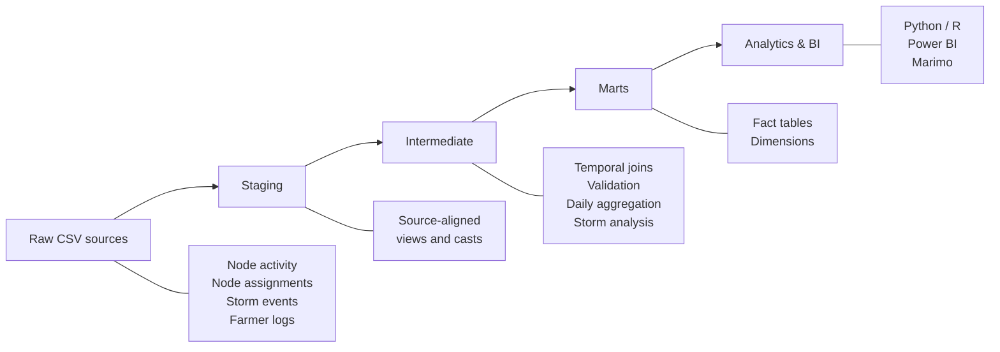

# Stingray Case Study — Analytics Engineer Interview

An end-to-end analytics engineering project that transforms operational data from underwater laser nodes into reliable, analysis-ready datasets for monitoring sea-lice detection and laser activity across salmon pens.

Built with **dbt Core, DuckDB, Marimo and Python**, the project demonstrates how raw operational data can be transformed into well-defined analytical models through reusable transformations, temporal data modelling, data-quality validation and tested business logic.

## Business context

Stingray operates underwater laser nodes that detect and remove sea lice in salmon pens. Understanding how environmental conditions, particularly storms, affect equipment availability and laser activity is important for monitoring performance and supporting operational decisions.

This project brings together four data sources:

- **Node activity:** Daily lice detections, laser shots and equipment uptime.
- **Node assignments:** Effective-dated relationships between nodes, sites and pens.
- **Storm events:** Site-level storm intervals and severity.
- **Farmer logs:** Manually reported fish counts for individual pens.

The objective is to create a consistent analytical foundation that allows users to compare operational activity across pens and sites, investigate changes around storm events, and assess the completeness of the underlying data.

## Key deliverables

- **Layered dbt pipeline:** Source-aligned staging, reusable intermediate transformations and reporting marts.
- **Dimensional data model:** Separate fact tables for daily operational monitoring and storm-event analysis.
- **Business metrics:** Consistent definitions for equipment uptime, detection activity and laser firing rates.
- **Data-quality framework:** Tests for model grain, temporal validity, missing telemetry, fish-count plausibility and calculation logic.
- **Traceable transformations:** Documented model dependencies and lineage from source data to reporting outputs.
- **Analytical presentation:** A Marimo-based case presentation with findings and a Power BI dashboard concept.

## Architecture

The project follows a layered architecture that separates source preparation, business logic and analytical outputs.



### Transformation layers

| Layer            | Responsibility                                                                                                     |
| ---------------- | ------------------------------------------------------------------------------------------------------------------ |
| **Raw**          | Original source extracts, preserved as read-only inputs.                                                           |
| **Staging**      | Source-aligned models that standardise names, data types and timestamps while retaining the original source grain. |
| **Intermediate** | Business logic, temporal joins, data validation, date spines, aggregations and analytical calculations.            |
| **Marts**        | Documented fact and dimension tables designed for reporting and downstream analysis.                               |
| **Consumption**  | Analytical workflows and reporting tools, including Python, R and Power BI.                                        |

The staging layer intentionally avoids business logic. Transformations that involve multiple sources or analytical assumptions are implemented in the intermediate layer, making the logic easier to test, reuse and maintain.

## Data model and analytical outputs

The reporting layer contains two fact tables, supported by shared dimensions.

### Fact tables

| Model                      | Grain                      | Purpose                                                                 |
| -------------------------- | -------------------------- | ----------------------------------------------------------------------- |
| `fct_pen_daily_activity`   | Site × pen × date          | Daily operational monitoring, trends and comparisons across pens.       |
| `fct_pen_storm_window_day` | Pen × storm episode × date | Comparing operational activity before, during and after storm episodes. |

### Dimensions

| Model               | Purpose                                                  |
| ------------------- | -------------------------------------------------------- |
| `dim_date`          | Consistent calendar attributes and local-day boundaries. |
| `dim_site`          | Site-level filtering and reporting.                      |
| `dim_pen`           | Pen-level filtering and reporting.                       |
| `dim_storm_episode` | Storm episode attributes for event-based analysis.       |

The two fact tables represent different analytical questions and are not directly joined to one another. Shared dimensions provide consistent filtering, while storm-specific attributes are available through the storm episode dimension.

### Core business metrics

The same metric definitions are used across both reporting facts.

| Metric                            | Definition                                   | Interpretation                                       |
| --------------------------------- | -------------------------------------------- | ---------------------------------------------------- |
| **Uptime %**                      | Uptime minutes / expected node minutes × 100 | Equipment availability.                              |
| **Detections per operating hour** | Lice detections / uptime hours               | Detection activity while equipment is operating.     |
| **Shots per operating hour**      | Laser shots / uptime hours                   | Laser firing activity while equipment is operating.  |
| **Shots per detection**           | Laser shots / lice detections                | Relationship between firing activity and detections. |

Rates are calculated from aggregated numerators and denominators rather than by averaging individual daily or node-level rates. Metrics return `NULL` when the relevant denominator is zero or unavailable.

**Important modelling considerations:**

- Missing telemetry is not interpreted as zero activity.
- Expected operating time accounts for assigned nodes and daylight-saving changes.
- Reporting completeness is exposed alongside operational metrics.
- Uptime represents reported node-on time, not necessarily laser-ready time.
- Fish counts are contextual information and are not used as denominators for the operational rates.
- Storm-window rows can overlap across episodes. Their measures should not be summed across episodes to produce daily operational totals.

## Data requirements

The project expects four source CSV extracts:

| Source                | Description                                                     |
| --------------------- | --------------------------------------------------------------- |
| `node_daily_activity` | Daily node-level operational measurements.                      |
| `node_pen_assignment` | Effective-dated node, site and pen assignments.                 |
| `storm_events`        | Site-level storm events with start/end timestamps and severity. |
| `farmer_pen_log`      | Farmer-entered fish counts and associated log metadata.         |

**Source data is not included in this repository.** The raw-data directory is excluded from version control. To run the pipeline, obtain the required extracts and place them in `data/raw/` using the filenames and schemas configured in the dbt source definitions.

The pipeline treats these extracts as read-only inputs and does not modify the original files.

## Getting started

### Prerequisites

- Python (version 3.14)
- [uv](https://docs.astral.sh/uv/)
- Git
- The four required source CSV extracts

### Installation

Clone the repository and install the project dependencies:

```bash
git clone https://github.com/siducky/stingray-ae-case.git
cd <repository-directory>

uv sync
```

### Configure the source data

Place the four required CSV files in `data/raw/`.

Check the source definitions in `models/staging/` to confirm the expected filenames and column structures.

### Verify the connection and build the warehouse

```bash
# Verify the dbt profile and DuckDB connection
uv run dbt debug --profiles-dir .

# Build staging, intermediate and mart models
# Run the associated tests
uv run dbt build --profiles-dir .
```

The build creates the local DuckDB warehouse at:

```text
data/warehouse/stingray.duckdb
```

### Generate dbt documentation

```bash
uv run dbt docs generate --profiles-dir .
uv run dbt docs serve --profiles-dir . --port 8080 --no-browser
```

Open `http://localhost:8080` to explore model documentation, dependencies and the dbt lineage graph.

## Common commands

All project commands are executed through `uv run`.

### dbt

```bash
# Build individual layers
uv run dbt build --select staging --profiles-dir .
uv run dbt build --select intermediate --profiles-dir .
uv run dbt build --select marts --profiles-dir .

# Run a specific model
uv run dbt run --select int_pen_daily_fish_count --profiles-dir .

# Execute tests only
uv run dbt test --profiles-dir .

# Generate documentation
uv run dbt docs generate --profiles-dir .
```

### Configuration overrides

Analytical thresholds and reporting assumptions are configurable through variables in `dbt_project.yml`.

For example:

```bash
uv run dbt build --select intermediate --profiles-dir . \
  --vars '{fish_count_max_age_days: 14, storm_baseline_days: 5}'
```

| Variable                   |       Default | Description                                                                                  |
| -------------------------- | ------------: | -------------------------------------------------------------------------------------------- |
| `site_timezone`            | `Europe/Oslo` | Timezone used for site-local calendar days and storm analysis.                               |
| `fish_count_plausible_max` |     `1000000` | Upper plausibility threshold for reported fish counts.                                       |
| `fish_count_max_age_days`  |           `7` | Maximum age of a fish-count snapshot before it is considered stale.                          |
| `storm_episode_gap_hours`  |          `24` | Events at the same site merge into an episode when the gap is strictly below this threshold. |
| `storm_baseline_days`      |           `3` | Number of local calendar days used for the pre-storm baseline.                               |
| `storm_post_days`          |           `3` | Number of local calendar days used for the post-storm period.                                |

The farmer-log timezone is separately configured as `Europe/Oslo` in staging.

### Python and Marimo

```bash
# Lint and format Python files
uv run ruff check --fix .
uv run ruff format .

# Validate notebooks
uv run marimo check notebooks/

# Open the exploratory notebook
uv run marimo edit notebooks/01_data_exploration.py

# Open the presentation
uv run marimo edit notebooks/stingray_case_presentation.py
```

## Data quality and testing

Data quality is treated as part of the transformation process rather than as a final reporting check.

The project combines dbt generic tests, singular SQL tests and unit tests to validate both structural integrity and business logic.

### Testing strategy

| Category                 | Examples                                                                                                |
| ------------------------ | ------------------------------------------------------------------------------------------------------- |
| **Schema and integrity** | Not-null constraints, unique keys and referential integrity.                                            |
| **Model grain**          | Uniqueness at node-day, pen-day, storm-day and episode-level grains.                                    |
| **Temporal logic**       | Effective-dated assignments, storm exposure across local calendar days and daylight-saving transitions. |
| **Business rules**       | Fish-count plausibility, snapshot freshness, missing telemetry and reporting completeness.              |
| **Calculation logic**    | Expected operating minutes, uptime percentages, operating rates and denominator handling.               |
| **Analytical windows**   | Before/during/after classification and protection against duplicate pen-days within an episode.         |

### Examples of edge cases covered

- A node changing pen assignment while its activity record is missing on the transition date.
- A storm spanning multiple local calendar days, including daylight-saving-aware day boundaries.
- Multiple farmer logs for the same pen and date, with deterministic selection of the latest entry.
- Implausible fish-count entries being flagged rather than silently corrected.
- Missing and zero-uptime records being treated differently.
- Overlapping and nested storm intervals when identifying storm episodes.

Run the full build and test suite with:

```bash
uv run dbt build --profiles-dir .
```

A successful build indicates that the configured models and associated tests completed without errors. Warning-level tests may still flag known source-data quality issues.

## Presentation and analytical exploration

The repository includes a Marimo-based presentation that demonstrates the analytical workflow and communicates the findings to a business stakeholder.

`notebooks/stingray_case_presentation.py` contains the presentation, while the supporting layout and theme files define slide configuration, speaker notes and styling.

The presentation queries the DuckDB marts read-only, so its reported figures are derived from the built warehouse.

### Run the presentation

```bash
uv run marimo edit notebooks/stingray_case_presentation.py
```

Open the app preview and select **Slides** in the layout dropdown. The saved slide layout is loaded from the `notebooks/layouts/` directory.

Alternatively, run the notebook without the editor interface:

```bash
uv run marimo run notebooks/stingray_case_presentation.py
```

The warehouse must be built before opening the presentation.

### Export to HTML

```bash
uv run marimo export html \
  notebooks/stingray_case_presentation.py \
  -o /tmp/stingray_deck.html
```

The export produces a self-contained HTML presentation with the rendered outputs, layout and theme.

## Limitations and production considerations

This project demonstrates production-oriented analytics engineering practices, but the current implementation is a local case-study environment rather than a deployed production pipeline.

The following areas would need further work before operational deployment:

| Area                       | Current implementation                                          | Potential production enhancement                                                       |
| -------------------------- | --------------------------------------------------------------- | -------------------------------------------------------------------------------------- |
| **Warehouse**              | Local DuckDB database                                           | Validate transformations and performance in the target Snowflake environment.          |
| **Data freshness**         | Full local builds without source freshness monitoring           | Add source freshness checks, data contracts and alerting.                              |
| **Reporting window**       | Source-driven reporting period based on observed activity dates | Introduce an explicit reporting end date to make end-of-period outages visible.        |
| **Timezone handling**      | Single configured site timezone                                 | Introduce a site-to-timezone lookup if multiple timezones are required.                |
| **Incremental processing** | Full-refresh models                                             | Evaluate incremental materialisations as data volume and processing requirements grow. |
| **Storm exposure**         | Current source data contains no overlapping storm events        | Implement merged-interval exposure calculations if overlapping events occur.           |
| **Operational monitoring** | Local execution and dbt tests                                   | Add scheduled orchestration, logging, monitoring and failure notifications.            |

The before/during/after storm comparison is descriptive. It identifies changes in operational metrics around storm episodes but does not establish causality or control for confounding factors such as seasonality, biomass or changes in the node configuration.

Additional device-status, maintenance and intraday telemetry data would be required to distinguish technical faults, deliberate shutdowns and telemetry gaps.

Further implementation details and scope decisions are documented in:

- [`docs/limitations.md`](docs/limitations.md) — assumptions, limitations and deliberate scope decisions.
- [`docs/production_portability.md`](docs/production_portability.md) — DuckDB portability considerations for Snowflake and PostgreSQL.

## Repository structure

```text
.
├── data/
│   ├── raw/                         # Source CSV extracts (not tracked)
│   └── warehouse/                   # Generated DuckDB database
├── models/
│   ├── staging/                     # Source-aligned staging models
│   ├── intermediate/                # Business logic and transformations
│   └── marts/                       # Reporting facts and dimensions
├── notebooks/
│   ├── 01_data_exploration.py       # Exploratory data analysis
│   ├── stingray_case_presentation.py # Marimo presentation
│   ├── theme.css                    # Presentation styling
│   └── layouts/                     # Slide layout and speaker notes
├── docs/
│   ├── diagrams/                    # Architecture and lineage diagrams
│   ├── limitations.md               # Scope decisions and limitations
│   └── production_portability.md    # Cross-warehouse portability notes
├── tests/
│   ├── staging/                     # Staging-level SQL tests
│   └── intermediate/                 # Intermediate-level SQL tests
├── src/stingray_ae_case/             # Python package
├── dbt_project.yml
├── packages.yml
├── profiles.yml
├── pyproject.toml
├── uv.lock
└── README.md
```

Generated artifacts such as `.venv/`, `target/`, `logs/`, `dbt_packages/` and `data/warehouse/` are excluded from version control.

## Diagrams

The `docs/diagrams/` directory contains version-controlled Mermaid diagram sources:

- `architecture.mmd` — layered architecture from raw data to reporting marts.
- `dag.mmd` — dbt model dependency graph generated from the manifest.

The Mermaid source files are the editable source of truth; rendered SVG and PNG files are generated outputs.

---

*This project was developed as an analytics engineering case study to demonstrate data modelling, transformation design, testing and analytical communication using a modern data stack.*
